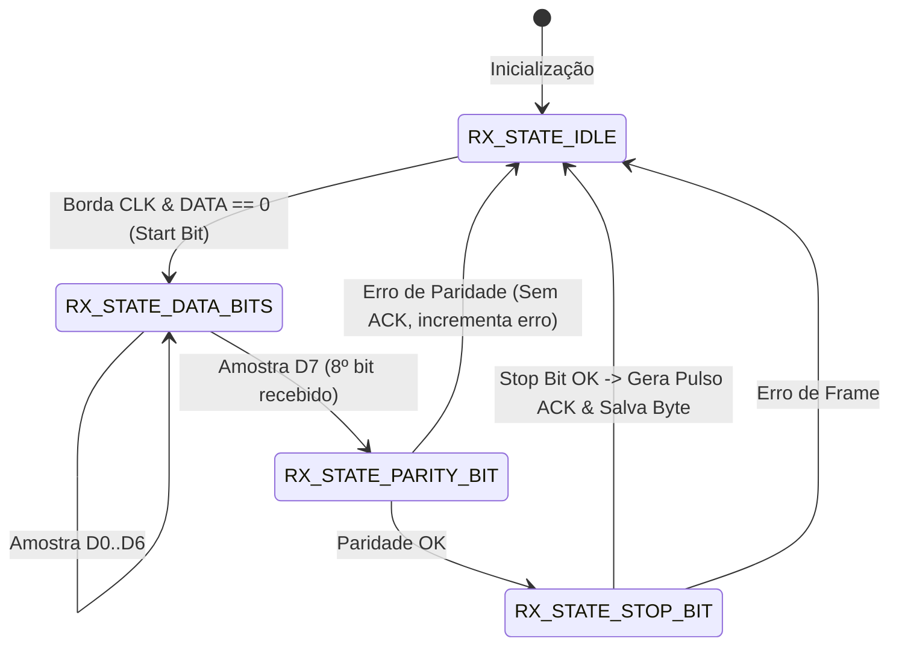

# Lab 1: Protocolo de Comunicação Digital via GPIO e NVIC (EXTI)
**Formação em Sistemas Embarcados Virtus-CC — Curso 2: Periféricos**  
**Prof. D.Sc. Rafael Bezerra Correia Lima**

---

> [!NOTE]
> **Estilo de Codificacao:** A arquitetura de firmware, nomenclatura de identificadores, utilizacao de BSP, struct de dados locais e padronizacao Doxygen deste repositorio foram inspiradas nas diretrizes de boas praticas do **Laboratorio ASSERT (IFPB)**.

## 1. Descricao do Protocolo Proprietario

Este protocolo foi desenvolvido do zero para permitir a troca confiável e rápida de dados em modo **Half-Duplex** entre duas placas STM32 utilizando estritamente pinos de entrada/saída de uso geral (**GPIO**) e o controlador de interrupções externas (**NVIC/EXTI**), sem depender de periféricos dedicados (UART, SPI, I²C).

### Critério Otimizado: **Robustez com Alta Velocidade**
- **Robustez:** Cada palavra de 8 bits conta com checagem de paridade par (*Even Parity*) e mecanismo de *Handshake* por confirmação ativa (**ACK/NACK**), com retransmissão automática em caso de erro.
- **Velocidade:** Temporização baseada no contador de ciclos de clock do núcleo ARM Cortex-M (**DWT Cycle Counter**), operando a uma taxa efetiva superior a **100 kbps** com amostragem na borda de subida do sinal de clock.

---

## 2. Pinagem e Interligação Física

| Linha / Periférico | Black Pill (F411) | STM32H723 | Nucleo-F767ZI | Descrição |
| :--- | :---: | :---: | :---: | :--- |
| **`PROTO_DATA`** | `PA0` | `PA0` | `PA0` | Linha serial de dados (LSB first) |
| **`PROTO_CLK`**  | `PA1` | `PA1` | `PA1` | Sinal de amostragem / EXTI1 |
| **`PROTO_ACK`**  | `PA2` | `PA2` | `PA2` | Handshake (Pulso LOW = Confirmação) |
| **`LED_STATUS`** | `PC13` (Ativo LOW) | `PC13` | `PB0` (Ativo HIGH) | Confirmação visual de integridade |
| **`GND`**        | `GND` | `GND` | `GND` | **OBRIGATÓRIO: Referência de terra comum** |

---

## 3. Formato do Frame de Dados

Cada byte transmitido é envelopado no seguinte frame de 11 tempos de bit:

```
 Repouso   START    D0    D1    D2    D3    D4    D5    D6    D7   PARITY   STOP    ACK Handshake
  (HIGH)   (LOW)   LSB ───────────────────────────────> MSB   (EVEN)  (HIGH)    (Pulso LOW)
───┐       ┌─────┬─────┬─────┬─────┬─────┬─────┬─────┬─────┬─────┬───────┐       ┌───────
   │       │ b0  │ b1  │ b2  │ b3  │ b4  │ b5  │ b6  │ b7  │  P  │       │       │
   └───────┴─────┴─────┴─────┴─────┴─────┴─────┴─────┴─────┴─────┘       └───────┘
```

1. **START Bit (0):** Linha DATA transiciona para nível baixo. O transmissor gera um pulso de clock em CLK para sincronizar a máquina de estados do receptor.
2. **Data Bits (D0 a D7):** 8 bits transmitidos do menos significativo (LSB) ao mais significativo (MSB). O receptor amostra o pino DATA a cada borda de subida de CLK.
3. **Parity Bit (P):** Paridade par (*Even Parity*). Se a soma dos bits em nível alto de D0..D7 for ímpar, o bit de paridade é 1, tornando o total de 1s par.
4. **STOP Bit (1):** Linha DATA retorna para nível alto, sinalizando o término do byte.
5. **ACK Handshake:** Se a paridade for válida e o STOP bit estiver correto, o receptor puxa a linha `PROTO_ACK` para nível baixo por $4\,\mu\text{s}$. O transmissor confirma a entrega e prossegue para o próximo byte.

---

## 4. Diagrama de Estados do Receptor (FSM na ISR do EXTI)



---

## 5. Roteiro de Validação dos 100 Bytes

Conforme exigido nas especificações do laboratório:
1. O transmissor gera um vetor de 100 inteiros de 8 bits (`0x00, 0x01, ..., 0x63`).
2. O transmissor envia o pacote completo invocando `GPIO_Proto_SendPacket(tx_test_payload, 100)`.
3. O receptor recebe os dados na interrupção do EXTI1, armazena no buffer e aciona a flag `GPIO_Proto_IsPacketReady()`.
4. O receptor compara byte a byte com o padrão esperado e pisca o LED on-board para confirmar $100\%$ de entrega correta.
5. Pelo depurador (Live Watch), é possível ler a estrutura `ProtoStats_t`:
   - `transfer_time_us`: Tempo total gasto para transferir os 100 bytes (usado para calcular a taxa de transferência).
   - `parity_errors`: Quantidade de erros de paridade.
   - `retransmissions`: Quantidade de retransmissões acionadas.

---

## 6. Como Alternar entre Transmissor e Receptor

No arquivo `Core/Inc/main.h`:
* Para gravar a placa **Transmissora (Módulo A)**:
  ```c
  #define IS_TRANSMITTER_NODE       1
  ```
* Para gravar a placa **Receptora (Módulo B)**:
  ```c
  #define IS_TRANSMITTER_NODE       0
  ```
